<p align="center">
  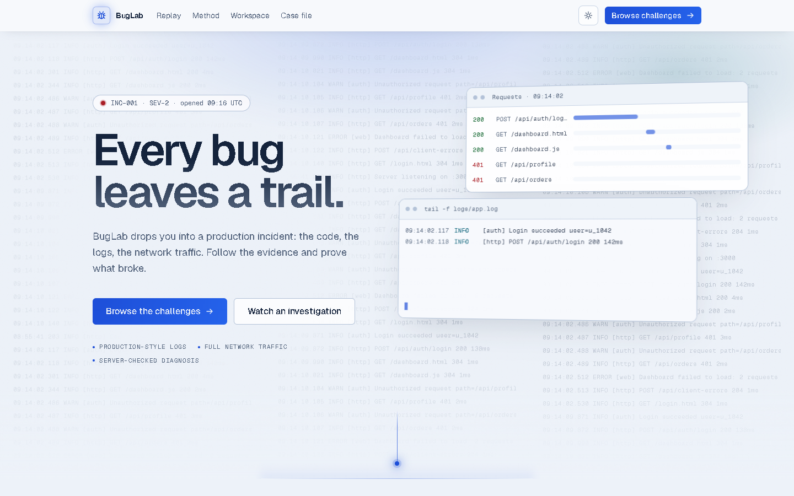
</p>

<h1 align="center">BugLab</h1>

<p align="center">
  <strong>Investigate incidents. Follow the evidence. Find the root cause.</strong>
</p>

<p align="center">
  An interactive debugging platform where learners investigate realistic simulated production incidents:<br>
  read-only code, server logs, network traffic, collected evidence, and a diagnosis the server grades.
</p>

<p align="center">
  Ordinary exercises ask for a function that returns the right value. Production incidents do not.
  BugLab starts from symptoms and leaves the learner to separate what broke from why.
</p>

<p align="center">
  <a href="#challenge-library">Challenge library</a>
  &nbsp;·&nbsp;
  <a href="#investigation-workspace">Investigation workspace</a>
  &nbsp;·&nbsp;
  <a href="#architecture-overview">Architecture</a>
  &nbsp;·&nbsp;
  <a href="#local-development">Run it locally</a>
  &nbsp;·&nbsp;
  <a href="#documentation">Documentation</a>
</p>

<p align="center">
  
  
  
  
  
  
  
  
</p>

<p align="center">
  <sub>Screenshots are from a local build on 6 November 2026. This repository does not publish a deployment URL. Account linking is gated. See <a href="#feature-status">feature status</a>.</sub>
</p>

---

## Contents

| | | |
|---|---|---|
| [What BugLab is](#what-buglab-is) | [Why it exists](#why-it-exists) | [Who it is for](#who-it-is-for) |
| [Learning objectives](#learning-objectives) | [Product walkthrough](#product-walkthrough) | [Challenge library](#challenge-library) |
| [Investigation workspace](#investigation-workspace) | [Diagnosis and grading](#diagnosis-and-grading) | [Two learning records](#two-learning-records) |
| [Anonymous learners](#anonymous-learner-identity) | [Verified completions](#verified-completions-and-progress) | [Reflections, Journal, Activity](#reflections-journal-and-activity) |
| [Recommendations](#personalized-recommendations) | [Learning Paths](#learning-paths) | [Authentication](#authentication-and-authorization) |
| [Architecture](#architecture-overview) | [Database](#database-design) | [Security](#security-architecture) |
| [API reference](#api-reference) | [Screenshots](#screenshots) | [Technology stack](#technology-stack) |
| [Repository structure](#repository-structure) | [Local development](#local-development) | [Environment variables](#environment-variables) |
| [Testing](#testing) | [Challenge authoring](#challenge-authoring) | [Contributors](#contributors-and-responsibilities) |
| [Roadmap](#roadmap) | [Limitations](#known-limitations) | [Documentation](#documentation) |

---

## Feature status

BugLab has two layers that are easy to conflate. The investigation product is what a learner uses with no configuration. The learner backend is mounted in this tree and tested, and it persists only when the process is configured for it. Neither layer is a production deployment.

| Area | In this tree | What a default local run actually does |
|---|---|---|
| Landing, library, workspace, live diagnosis | Implemented, mounted, tested | Available. Diagnosis is graded by `POST /api/challenges/[challengeId]/diagnosis`. |
| 30 published challenges | Implemented | Served from the in-repo catalog. Answer keys stay on the server. |
| Browser Journal, Progress, recall | Implemented, mounted | Stored in this browser (`buglab.learning.v2`). Cleared with site data. |
| Learning Path page and `GET`/`POST /api/recommendations/v1` | Implemented, mounted, tested | Suggestions use the published catalog and, if the learner opts in, browser activity dates. Verified completion history is not connected. |
| Anonymous learner APIs | Implemented, mounted, tested | Process memory unless `BUGLAB_DATABASE_URL` is set. The workspace does not call these routes. |
| PostgreSQL learner store | Implemented, covered by `npm run test:db` | Opt-in. Migrations `0001`, `0002`, `0004`, and `0005` must be applied first. |
| Better Auth accounts | Implemented, covered by `npm run test:auth` | The account UI connects only in a non-production build with `NEXT_PUBLIC_BUGLAB_ACCOUNTS=enabled`, and the server still needs its own auth configuration. |
| Google sign-in and SMTP delivery | Implemented behind configuration | Not active unless both Google credentials, or a real SMTP service, are set. Not live-tested in this documentation pass. |
| Account-to-learner linking and migration `0003` | Schema and adapter exist | **Gated.** The mounted account route does not receive a learner adapter. `POST /api/account/link` returns unavailable. |
| Production deployment | Not in this repository | No public URL, no production auth verification flag, no claim that these routes are deployed. |

Anonymous solving stays available. A browser cannot declare its own verified completion.

---

## What BugLab is

BugLab is a developer-education product for incident investigation.

A challenge is a simulated incident: a short case file, a read-only codebase, a log stream, and a set of HTTP exchanges captured from that incident. The learner reads the code, correlates logs with requests, keeps notes, collects evidence, and submits a root-cause diagnosis. The server compares that diagnosis with a private answer key and returns either investigation hints or a resolution.

It is not a live observability product. Nothing here attaches to a real production system. It is not a sandbox that executes learner code. The editor is read-only on purpose: the skill being practiced is inspection, not patching a live process.

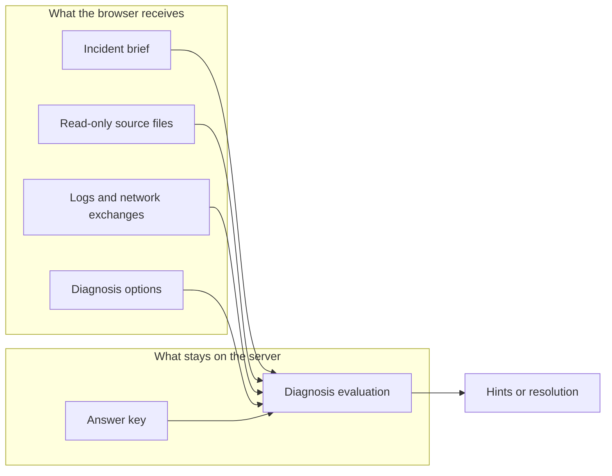

## Why it exists

Most coding exercises collapse the investigation. The prompt already names the bug, the function is small enough to hold in your head, and success is a green test. Incident work is the opposite. The page loads, or it does not. A customer can sign in, and the next request fails. The log line that looks guilty is often a symptom.

BugLab keeps that gap. The incident brief states impact and a task. It does not state the cause. Several explanations are plausible. Evidence is something the learner chooses, not a highlight the page applies for them. The graded moment is a diagnosis with a written explanation, not a diff.

That is also why a correct click is not the whole product. The resolution tells the learner what the server accepted. Notes, reflections, and the next recommendation are there so the reasoning survives the challenge.

## Who it is for

- Students who can write features and have not yet had to explain a production failure.
- Junior developers on call for the first time, or about to be.
- Backend engineers practicing API, authentication, and data-integrity failures.
- Frontend engineers practicing rendering, state, and browser-behavior incidents.
- Full-stack engineers who need to move between a request, a log line, and a query.
- Anyone who wants deliberate practice at debugging, separate from shipping a feature.

## Learning objectives

A challenge asks the learner to:

- Read unfamiliar code without running it.
- Follow a request from the edge of the service into the module that handles it.
- Correlate a log line with a network exchange and a timestamp.
- Separate a symptom ("dashboard requests return 401") from a cause.
- Hold more than one hypothesis, and drop one when the evidence contradicts it.
- Recognize common API, database, security, and performance failure shapes.
- Write the finding in a form another engineer can check.

The catalog covers authentication, APIs, React, data integrity, security, and production performance. Individual challenge causes are not listed in this document.

---

## Product walkthrough

1. Open the landing page and go to the Challenge Library.
2. Filter or search, then open a case. The page is the incident brief: summary, impact, and what to investigate.
3. Enter the workspace. Browse files, read logs, inspect requests.
4. Collect evidence and write down what you think is happening.
5. Submit a diagnosis. The server grades it.
6. On an incorrect diagnosis, use the hints and keep investigating.
7. On a correct diagnosis, read the resolution. The browser can record the solve and offer a reflection. That browser record is not a server-verified completion.
8. Journal, Progress, and Learning Path continue the practice from what this browser has stored, plus the published catalog.

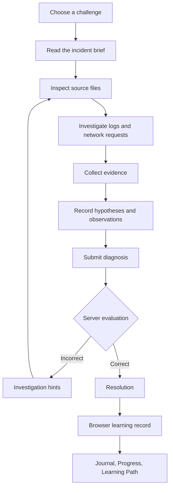

The server can also record a verified completion on `challenge_sessions`, through the learner session APIs. The workspace button does not call that path. See [Two learning records](#two-learning-records).

---

## Challenge library

<p align="center">
  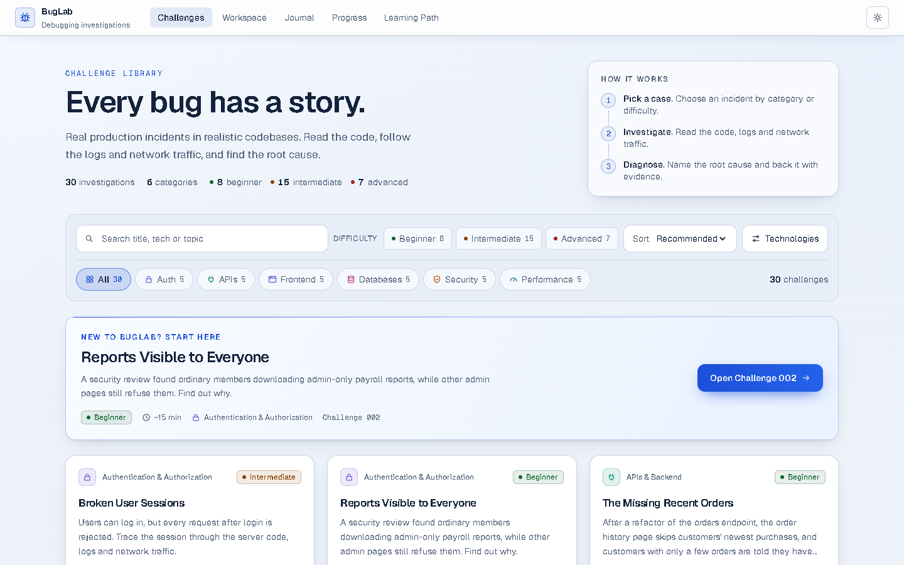
</p>

The library is the catalog of published investigations. On 6 November 2026 the running app reported **30 published investigations**, **6 categories**, **8 beginner**, **15 intermediate**, and **7 advanced**.

| Category | Investigations | What the cases practice |
|---|---:|---|
| Authentication & Authorization | 5 | Logins, sessions, tokens, and access control |
| APIs & Backend | 5 | HTTP endpoints, contracts, and server-side logic |
| Frontend & React | 5 | Rendering, state, and browser behavior |
| Databases & Data Integrity | 5 | Queries, transactions, and consistency |
| Security & Vulnerabilities | 5 | Injection, access control, and unsafe input |
| Performance & Production | 5 | Latency, memory, caching, and production failure |

Challenges are defined with `defineChallenge`. The default status is `published`. A category appears in the library only when at least one published challenge belongs to it. Unpublished challenges stay out of the public registry; the diagnosis route also refuses a challenge that is not published.

The library supports:

- Search across title, technology, and topic.
- Category chips, including an "all" view.
- Difficulty filters: beginner, intermediate, advanced.
- A technology filter.
- Sort, including the recommended order.
- Filter state in the URL, so a filtered view can be shared or restored.

Each card shows difficulty, an estimated time, the category, and a short incident statement. Opening a card goes to the challenge page, which carries the brief into the workspace. Status in the workspace starts as not started and moves to investigating once the learner collects evidence. That status is the workspace session in the tab. Refreshing the tab resets notes and evidence. The page says so.

<p align="center">
  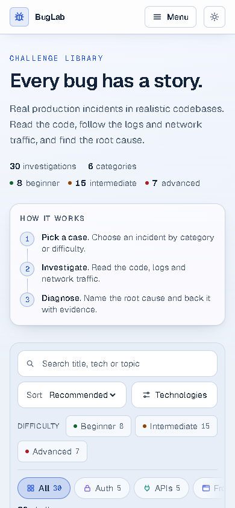
</p>

---

## Investigation workspace

<p align="center">
  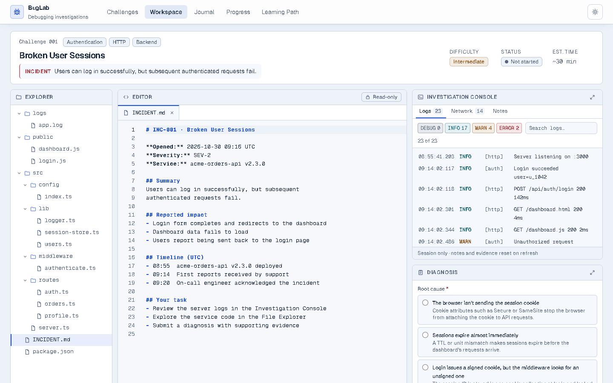
</p>

The workspace is the product. At a wide desktop width it is three columns: a file explorer, a read-only editor, and a right rail with the investigation console above the diagnosis form. Narrower widths stack those regions. The layout is specified for a laptop or desktop investigation, not a phone-sized editor.

### Incident brief

The brief is the case file, rendered in the editor as `INCIDENT.md` and summarized in the page header.

- What users are experiencing.
- Severity, service, and when the incident was opened, when the challenge provides them.
- Reported impact.
- A timeline of what changed and when support heard about it.
- The investigation task: review logs, read the code, submit a diagnosis with evidence.

The brief is context. It is not the answer.

### File explorer and Monaco

<p align="center">
  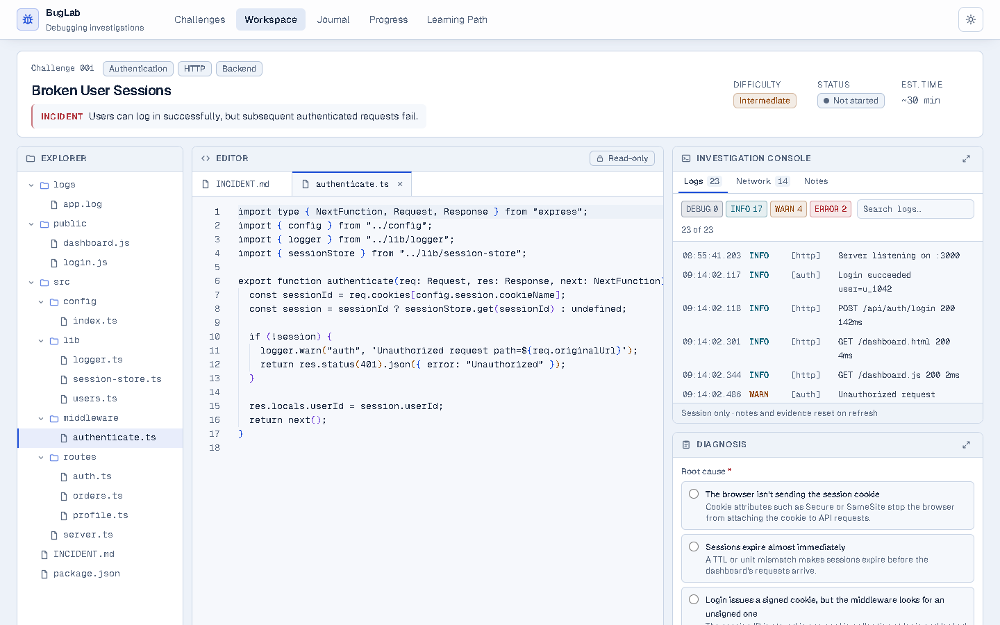
</p>

- The explorer is an accessible tree. Folders expand in place. Opening a file adds a tab.
- Monaco provides syntax highlighting, a read-only buffer, and the BugLab theme.
- Assets are self-hosted from the repository's Monaco copy (`npm run monaco:copy` before dev and build). The editor does not load them from a third-party CDN.
- Files are challenge content shipped with the app. The learner inspects them. The app does not execute them, and it does not accept a patch.

Answer keys live in server-only modules (`*.server.ts` and the server challenge registry). They are not part of the public file tree.

### Investigation console

The console has three tabs: Logs, Network, and Notes.

**Logs.** Each challenge ships a captured log stream with timestamps, levels, and messages. The learner can filter by severity and search the text. Selecting a line opens its detail and can add it to the evidence set.

<p align="center">
  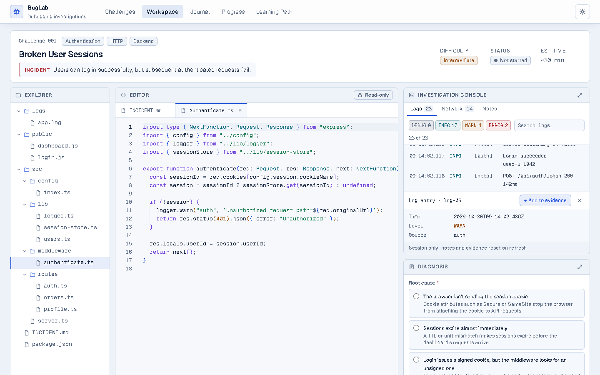
</p>

**Network.** The same incident includes HTTP exchanges: method, path, status, type, and timing. Filters narrow by request type. Selecting a row shows headers and the response, and the same evidence action.

<p align="center">
  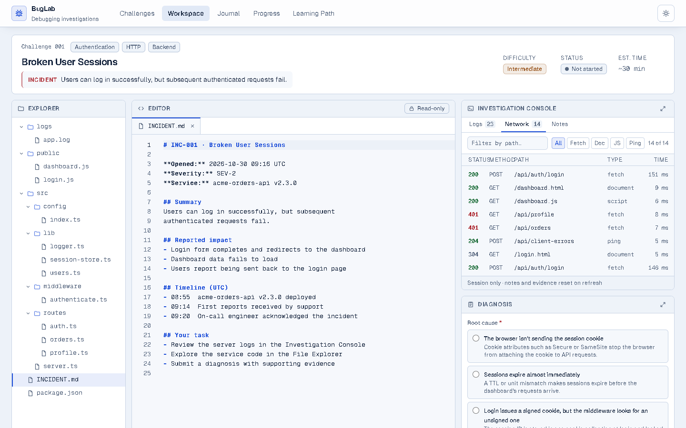
</p>

Where a challenge's evidence includes timestamps, the learner correlates the log clock with the request list. The console does not query a live system. Both panels are fixtures authored with the challenge.

### Evidence, notes, and hypotheses

<p align="center">
  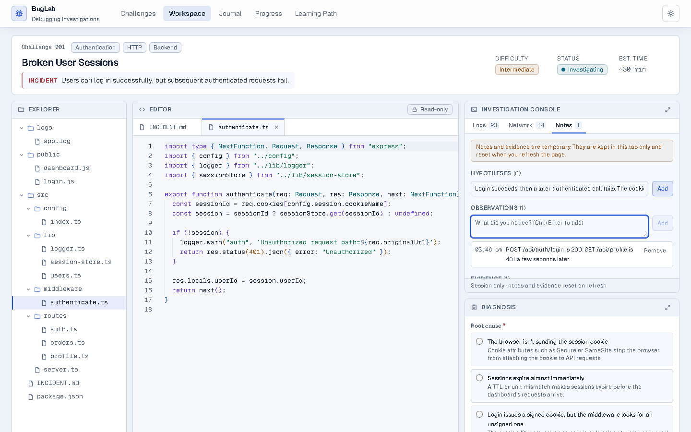
</p>

- A log line or a request can be added to the evidence set, then removed.
- An evidence item can carry a short note about why it matters.
- Hypotheses are competing explanations. Observations are facts the learner does not want to lose.
- Notes and evidence live in the tab. The console states that a refresh clears them. They are not the server learner record and they are not the browser Journal.

The point of the notes is to slow the leap from the first plausible file to a diagnosis.

---

## Diagnosis and grading

The diagnosis form asks for three things: a root-cause option, a written explanation, and the evidence the learner wants attached. The workspace posts that payload to:

```http
POST /api/challenges/{challengeId}/diagnosis
Content-Type: application/json
```

The route is same-origin. It validates the body, checks that the challenge is published, and evaluates the choice against the server-only answer key. The client does not receive the key, and a client-supplied "correct" flag is not how grading works.

| Result | What the learner gets |
|---|---|
| Incorrect | Investigation hints written for that challenge, plus the remaining attempt budget in the current window. |
| Correct | A resolution, evidence-coverage feedback, and the browser's optional reflection prompt. |
| Invalid or rejected | A validation or origin error. No completion is recorded. |
| Limited | The live route enforces an in-process attempt window. This limiter is not the PostgreSQL rate-limit table. |

<p align="center">
  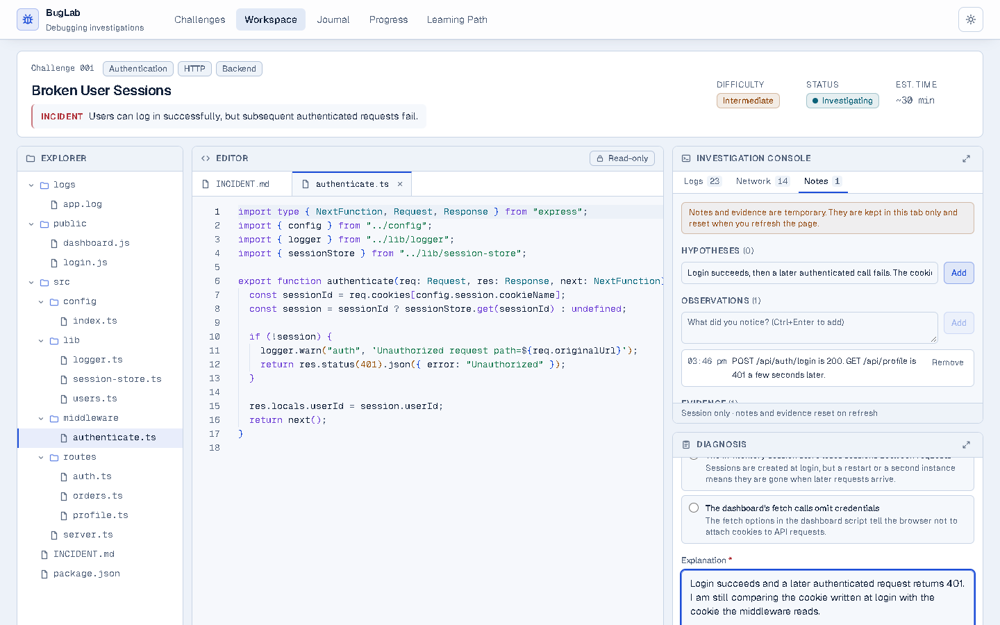
</p>

<p align="center">
  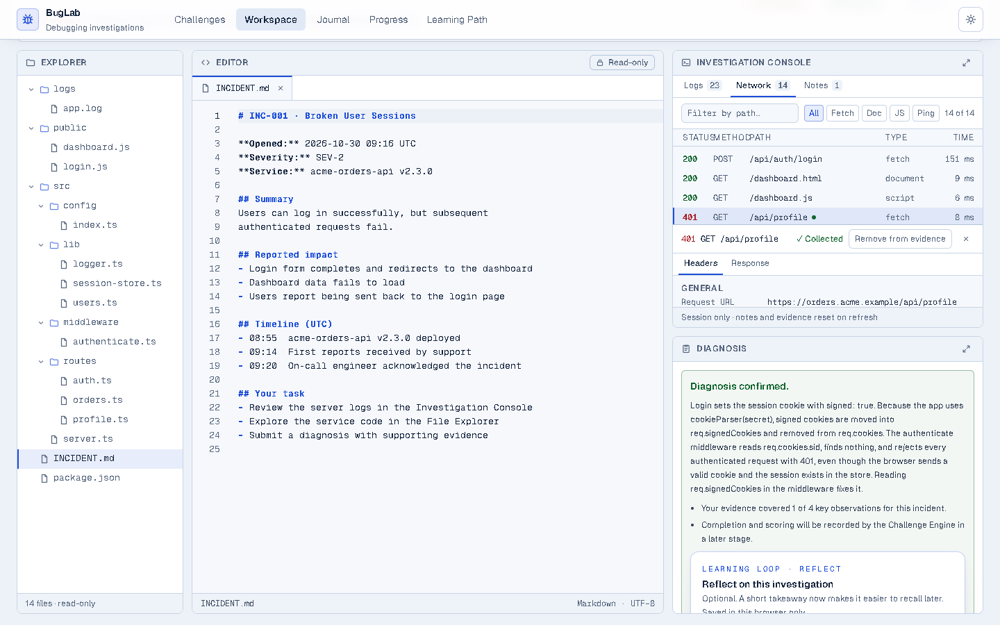
</p>

A correct response from this route confirms the diagnosis. It does not, by itself, insert a row into `challenge_sessions`. The browser then offers to remember the solve locally. Treat that as a learning note on this device.

There is a second, unmounted diagnosis factory under the learner session service. It is not the route the workspace calls.

---

## Two learning records

BugLab keeps two records because they answer different questions.

| | Browser learning record | Server learner record |
|---|---|---|
| Question it answers | What has this browser practiced, reflected on, and scheduled for recall? | What has this anonymous learner verifiably completed, according to the server? |
| Where it lives | `localStorage` key `buglab.learning.v2` | Process memory, or PostgreSQL when `BUGLAB_DATABASE_URL` is set |
| What writes it | The workspace, after a server-confirmed correct diagnosis, and the Journal UI | `POST /api/learner`, challenge session routes, and the learning-loop routes |
| What reads it in the default UI | Journal, Progress, and the optional Learning Path activity signal | Nothing. The verified-completions client is disconnected unless a development flag is on. |
| Can it grant a verified completion? | No | Only a server-side transition of `challenge_sessions` to `completed` |

The pages below are the browser record. They say so on the page.

<p align="center">
  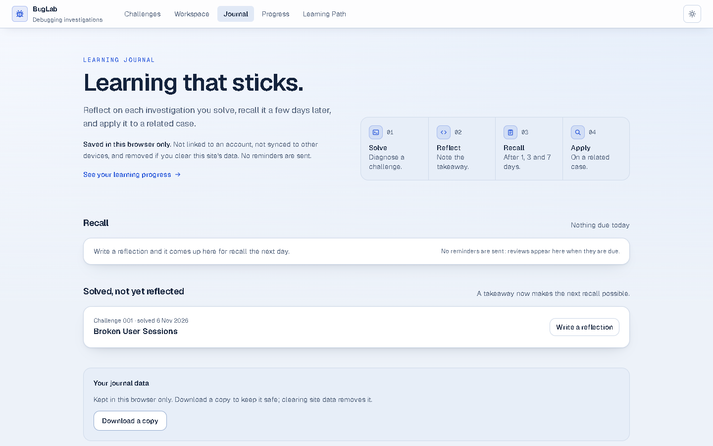
</p>

<p align="center">
  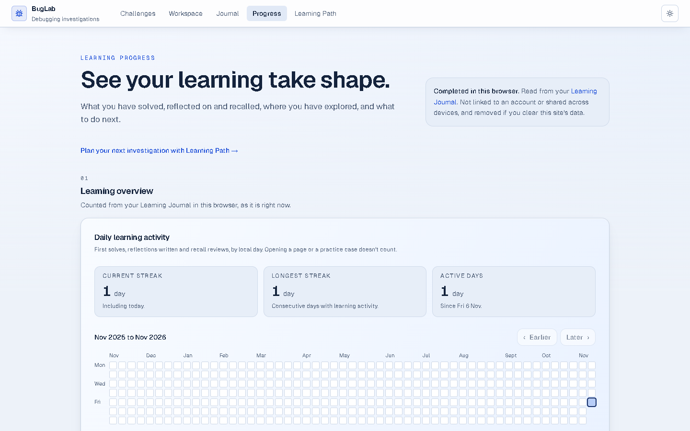
</p>

The Progress screenshot is the browser Progress page. There is no separate Activity page. Server activity is `GET /api/learning/activity`.

## Anonymous learner identity

A learner can investigate with no account. The server identity, when a client uses the learner API, is an HttpOnly cookie named `buglab_learner`. The database stores a SHA-256 hash of the token, not the token. Identity is that credential. The client does not send a learner id to be trusted.

`GET /api/learner` with no cookie reports that there is no learner and does not create one. Creating or resuming a learner is `POST /api/learner`. Private reads and writes without a valid cookie fail closed.

The cookie path, expiry, and rotation rules live in the session service. This document does not publish token samples or cookie flags beyond the properties above. See [Learner session foundation](docs/architecture/learner-session-foundation.md).

In the default workspace this cookie is unused. Solving a challenge in the UI does not create a server learner.

## Verified completions and progress

A verified completion is a `challenge_sessions` row whose status is `completed`, produced by the server session service after it accepts a diagnosis for that session. Attempts are a separate history: submitted, incorrect, or correct. An incorrect attempt is history. It is not a completion. A client field named `completed`, `verified`, or `learnerId` does not create one.

Sessions are per learner and challenge. A session carries the challenge content version. An outdated session can be superseded by starting again. A completed session is immutable: migration `0004` adds a trigger that rejects changes to `status`, `completed_at`, and `result` once a session is completed.

`GET /api/learner/completions` lists those rows for the cookie's learner. Progress derived from that list is a view over the authoritative table, not a second progress database.

The browser source that would call this endpoint (`src/lib/verified/config.ts`) stays disconnected unless both of these are true at build time:

- `NEXT_PUBLIC_BUGLAB_VERIFIED_COMPLETIONS` is exactly `enabled`
- `NODE_ENV` is not `production`

A production build never calls it, whatever the flag says. Recommendations also refuse client-supplied verified history. See the next section.

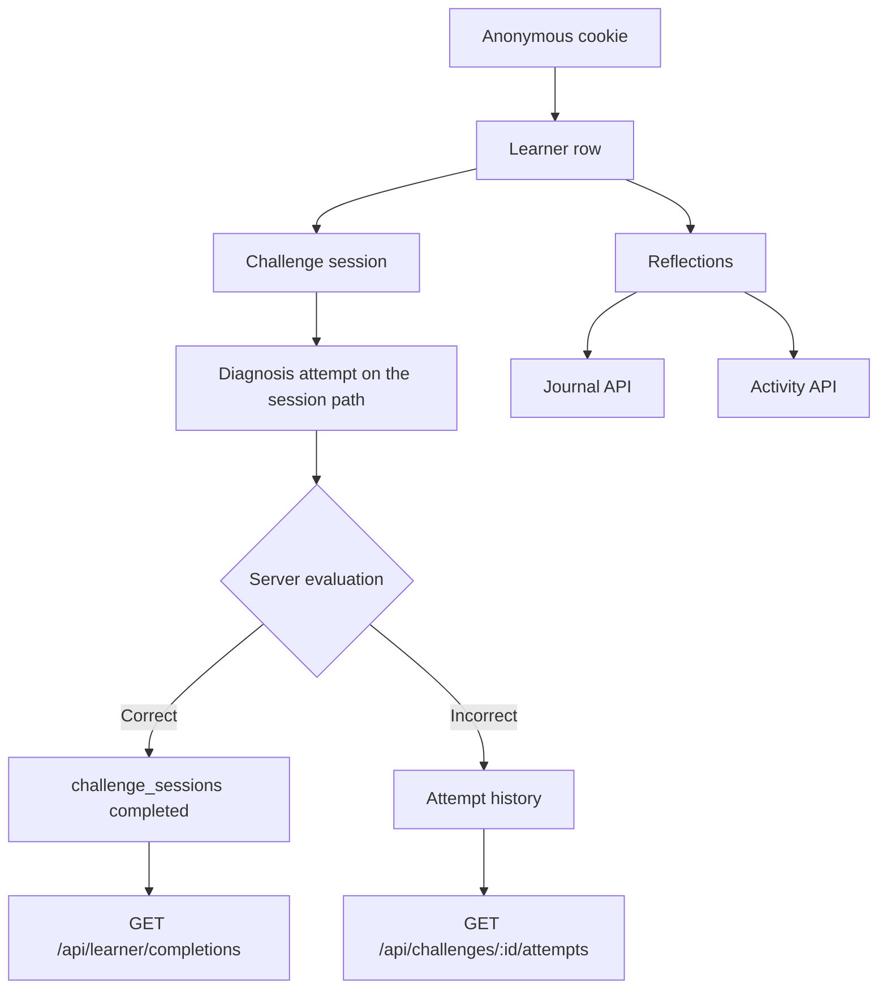

This diagram is the server path. The workspace diagnosis button is not an arrow into it.

## Reflections, Journal, and Activity

**Server reflections** are rows in `learning_reflections`. The stored field is a body of text, plus identity, the challenge, the completed session that authorizes the reflection, revision, and timestamps. A reflection requires a session that belongs to the same learner and challenge. One active reflection is allowed per learner and challenge; a soft delete frees the slot. Body text is private. Recommendation code does not receive it.

`GET /api/learning/journal` and `GET /api/learning/activity` are derived views over that learner's server data. They are not a second store of completions.

**Browser Journal** is the page at `/journal`. It is the solve, reflect, recall, and apply loop kept in this browser: write a takeaway, review it on a schedule, apply it to another case. The page states that nothing is synced to an account and that no reminders are sent. `/progress` counts active days from that same browser record. Opening a page does not count as learning activity.

Both are real. They do not substitute for each other. Account linking, which is gated, also refuses to import browser solves as verified completions.

---

## Personalized recommendations

<p align="center">
  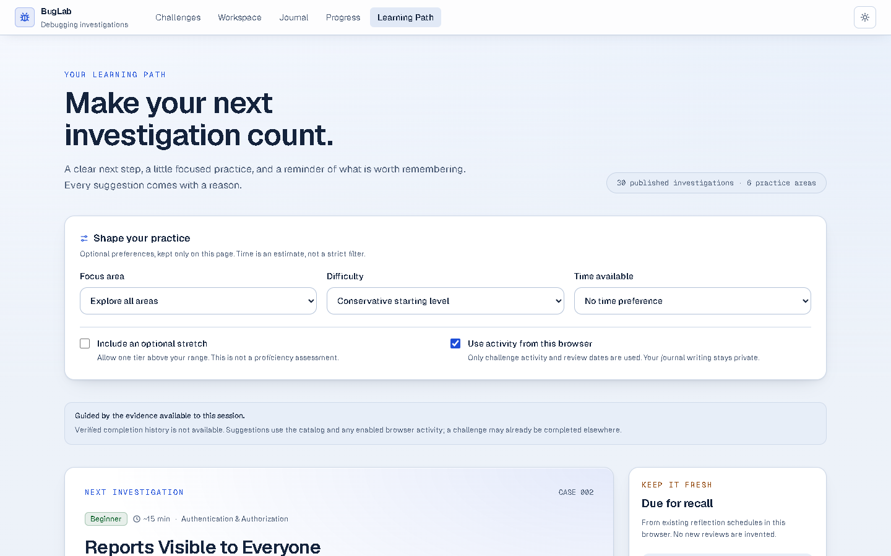
</p>

The Learning Path recommends a next published investigation. It is a deterministic catalog ranker, not an external model. `@google/genai` is a dependency for a separate optional evaluator and is not this ranker.

What the handler may use:

- The published catalog: category, difficulty, technologies, and public challenge metadata.
- Optional browser activity dates, only when the learner leaves "Use activity from this browser" on. The page states that journal writing stays private.
- Recall dates already stored in the browser, for the "due for recall" panel. The page does not invent reviews.

What it must not use, and what the handler rejects if a client tries to inject it:

- Answer keys and root-cause identifiers.
- Private diagnosis explanations and evidence payloads.
- Full reflection text.
- A client-supplied verified-completion list or learner id.
- Browser solves, treated as server completions.

The mounted handler is constructed with disconnected verified history (`createRecommendationHandler()` with no connected history source). The page says so: suggestions use the catalog and any enabled browser activity, and a challenge may already be completed somewhere else. Same-origin checks apply to the recommendation request.

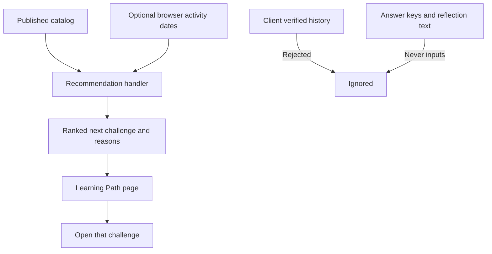

Reason strings explain the rank in product language (fit, difficulty, practice area). They do not describe another learner's data. Details: [Personalized recommendations](docs/architecture/personalized-recommendations.md) and [Recommendations API v1](docs/architecture/recommendations-api-v1.md).

## Learning Paths

`/learning-path` is the page. The learner can set a focus area, a difficulty posture, and a time preference. Those preferences stay on the page. An optional stretch challenge can sit one step above the current range. The next card links into the challenge. Recall due dates come from the browser schedule.

Generating a path does not write `challenge_sessions` and does not mark anything complete.

---

## Authentication and authorization

Three identities stay separate.

| Identity | What it is | Active by default? |
|---|---|---|
| Anonymous learner | `buglab_learner` cookie and the learner tables | The API is mounted. The workspace does not use it. Persistence is memory unless Postgres is configured. |
| Account | Better Auth user, credential, verification, and account session | Only when the auth runtime is configured and the account UI is connected. |
| Linked learner | One account id mapped to one learner id | **Gated.** Not wired. |

Better Auth owns account tables and the account session. BugLab owns learners, challenge sessions, attempts, completions, reflections, and the link table. There is no foreign key from learner tables into auth tables. An account id stored for a future link is an opaque string, the Better Auth user id.

Account capabilities in this tree:

- Email and password sign-up, sign-in, and sign-out, when the runtime is up.
- Email verification and password recovery. Delivery is a local capture directory when `BUGLAB_EMAIL_MODE=capture`, or SMTP when SMTP is configured. Capture is for development. Production delivery needs a real provider.
- Google sign-in only when both `GOOGLE_CLIENT_ID` and `GOOGLE_CLIENT_SECRET` are set. The only public Better Auth route is `GET /api/auth/callback/google`. Any other `/api/auth/*` path is not found. Missing Google configuration returns unavailable.
- Account pages for profile, security (password change, session list, revoke), and the link screen.
- Server-side session reads through Better Auth with cookie cache and refresh disabled on that read.
- Roles. The provider default is `learner`, and public sign-up cannot set a role. The allowlist is email, password, and name. There is no admin registration and no admin provisioning UI. An authenticated learner who calls an admin permission is denied. Anonymous callers on protected account operations are unauthenticated.
- Production auth stays off until `BUGLAB_AUTH_PRODUCTION_VERIFIED=enabled`, together with HTTPS and a real mail transport. That flag was not set for the screenshots in this document.

<p align="center">
  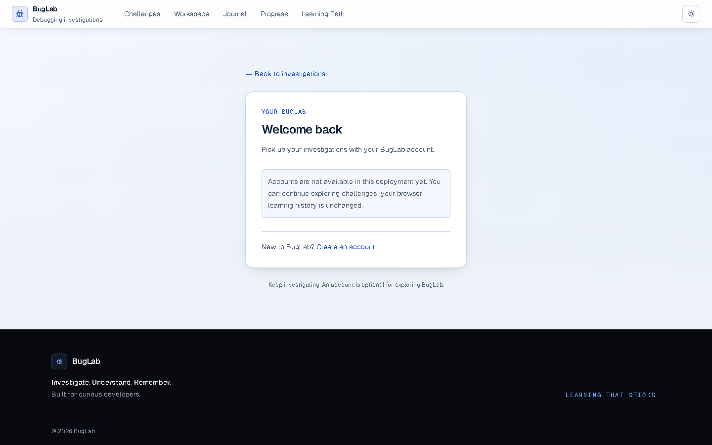
</p>

The screenshot is the honest production-build state: `NEXT_PUBLIC_BUGLAB_ACCOUNTS` cannot connect the account client when `NODE_ENV` is `production`. Development can connect it with the flag, and the server still returns unavailable until Better Auth's own configuration is complete. Operations: [Authentication operations](docs/authentication-operations.md) and [Accounts and RBAC](docs/architecture/accounts-and-rbac.md).

**Linking** is specified and deliberately not activated. `src/app/api/account/[...path]/route.ts` calls `createAccountHandler()` with no learner option. The link branch returns 503 unavailable. Migration `0003` is not applied by the running app. `npm run test:db` may apply it inside a throwaway database. That is not an activation.

---

## Architecture overview

| Layer | Role |
|---|---|
| `src/app` | Routes: marketing and product pages, account pages, and the route handlers below. |
| `src/components` | Landing, library, workspace, journal, progress, learning path, account UI. |
| `src/data` | Public challenge content. Private keys sit beside it in server-only files. |
| `src/server/challenges` and `src/server/diagnosis` | Publication, public views, origin checks, the live diagnosis route's dependencies. |
| `src/server/session` and `src/server/learner-http.ts` | Anonymous learner HTTP. Memory by default. Postgres when the URL is set. |
| `src/server/learning-loop` | Reflections and the derived journal and activity handlers. |
| `src/server/account` and `src/server/auth` | Better Auth runtime, the account boundary, verified account, permissions. |
| `src/lib/recommendations` | Catalog ranking and the v1 handler. |
| `src/engine` | Client-side challenge session model used by the workspace UI. It is not the server `challenge_sessions` table. |
| `db/migrations` | Learner schema. Better Auth migrates its own tables separately. |

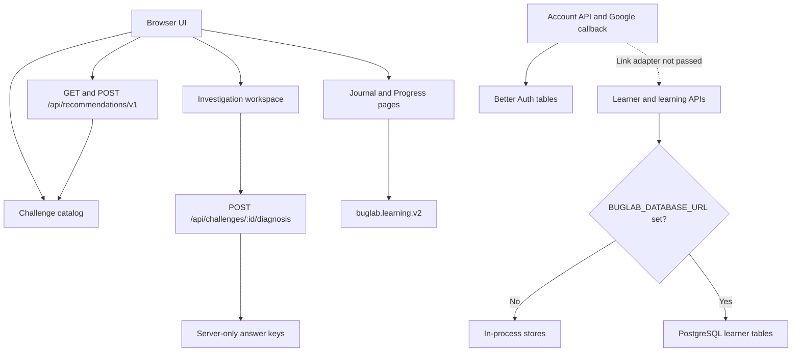

`src/server/app-services.ts` stays on in-memory stores and does not open Postgres. `src/server/learner-http.ts` is the composition root that may. If the database URL is set and the database is unreachable, the process does not silently fall back to memory.

The security boundary is the route. Public challenge modules are safe to serialize to the client. Anything that can grade a challenge is imported only from server code. Diagnosis requests that fail the origin check are rejected. Recommendation requests that carry a forged history are rejected.

## Database design

Learner migrations live in `db/migrations` and are applied by `npm run db:migrate` using `BUGLAB_DATABASE_URL_DIRECT`. The runtime pool is `BUGLAB_DATABASE_URL`. Checksums are recorded; applied files are not edited in place.

| Migration | What it creates | Status in the running app |
|---|---|---|
| `0001_learner_sessions.sql` | `learners`, `challenge_sessions`, diagnosis attempts | Apply before Postgres runtime. Not applied if the URL is unset. |
| `0002_rate_limit_buckets.sql` | Fixed-window counters keyed by an opaque digest, not a raw address | Same as `0001`. The live diagnosis limiter does not use this table. |
| `0003_account_links.sql` | Optional anonymous credential, `account_learner_links`, purge rules that keep a linked learner | **Gated.** Do not apply as part of enabling the learning loop. |
| `0004_learning_reflections.sql` | Completion immutability trigger, `learning_reflections` | Apply with `0003` excluded. |
| `0005_diagnosis_submission_claims.sql` | A short lease for an in-flight session-path submission | Depends only on `0001`. |

Apply the learning schema without linking:

```bash
npm run db:migrate -- --through 0004_learning_reflections --exclude 0003_account_links
```

Then apply `0005` by the same runner. Leave `0003` pending until linking is explicitly approved. Review notes: [Migration 0003](docs/architecture/migration-0003-better-auth-review.md).

Ownership rules that the schema enforces:

- A learner id is opaque text. The token column is a 64-character hex hash, unique, and never the raw cookie.
- Sessions reference the learner and store the challenge content version. Status is `active` or `completed`.
- Attempts belong to a session. Their outcome is a finished correct or incorrect result, which is why in-flight work needed its own table.
- `diagnosis_submission_claims` is that in-flight lease: one row per session and submission id, removed in the transaction that writes the finished attempt.
- A reflection's foreign key requires the session, learner, and challenge to match. The body is at most 16 KiB. Soft delete is `deleted_at`.
- Better Auth tables are created by the auth schema script, not by these files.

`0003` would make the anonymous credential optional and add a one-to-one link. Until it is applied and the adapter is passed into the account handler, those columns and that table are not part of the running schema.

## Security architecture

Controls below are ones the implementation and its tests actually contain.

| Control | Where it holds |
|---|---|
| Server-only answer keys | `*.server.ts` and the server registry. Public views are a separate projection. |
| Published-challenge gate | Library and the live diagnosis route. |
| Diagnosis origin checks | Live diagnosis route. `BUGLAB_APP_ORIGIN` when the app is behind a proxy that must not be trusted to invent the origin. |
| Diagnosis attempt window | In-process limiter on the live route. |
| Learner cookie | HttpOnly credential. Only the hash is stored. |
| Learner route authentication | Missing or unknown cookie: no private read or write. `GET /api/learner` without a cookie creates nothing. |
| Cross-learner isolation | Session, attempt, completion, and reflection queries are scoped to the cookie's learner. |
| Completion immutability | Trigger from migration `0004`, plus the service, which does not reopen a completed session. |
| Submission claims | Idempotent lease in `0005` for the session-path evaluator. Not the live workspace route. |
| Postgres transactions | Session finalization and reflection writes run in the store's transaction boundary. |
| Account default deny | No runtime means account operations return unavailable. No session means protected account operations are unauthenticated. |
| Role | Public sign-up cannot submit a role. Admin permission is denied for a learner. No admin UI is mounted. |
| Registration allowlist | Email, password, and display name are the fields forwarded to Better Auth. |
| Recommendation privacy | Disconnected verified history. Injected completions, keys, and reflection bodies are not inputs. |
| Linking | Handler is constructed without the adapter. |
| Monaco hosting | Assets copied into the app and served by it. |
| DOMPurify | Monaco 0.57.0 vendors DOMPurify 3.4.15 and calls it with a fixed tag allowlist. The remediation note and the follow-up are in [Monaco self-hosting](docs/architecture/monaco-self-hosting.md). This README does not claim a newer DOMPurify than the one Monaco vendors. |

Rate-limit buckets in Postgres store a digest. They are used by the learner-creation guard when Postgres persistence is selected. They are not a global edge limiter, and they are not what the live diagnosis route uses.

---

## API reference

Mounted handlers in this tree. "Auth" means the credential that route requires, not a suggestion to send a bearer token. Persistence is the learner store: memory, or Postgres when `BUGLAB_DATABASE_URL` is set. Account routes use Better Auth's database, which is separate.

### Learner and learning

| Method | Route | Purpose | Auth | Persistence |
|---|---|---|---|---|
| `GET` | `/api/learner` | Report whether a learner cookie is present, without creating one | Cookie optional | None on an empty request |
| `POST` | `/api/learner` | Create or resume the anonymous learner | Cookie issued by the server | Learner row |
| `GET` | `/api/learner/completions` | List verified completions for that learner | Learner cookie | Read `challenge_sessions` |
| `GET`, `POST` | `/api/challenges/[challengeId]/session` | Read, start, or resume the session. Restart replaces an outdated one | Learner cookie | Session row |
| `GET` | `/api/challenges/[challengeId]/attempts` | Attempt history for that learner and challenge | Learner cookie | Read attempts |
| `GET`, `POST` | `/api/learning/reflections` | List or create a reflection for a completed session | Learner cookie | `learning_reflections` |
| `GET`, `PATCH`, `DELETE` | `/api/learning/reflections/[reflectionId]` | Read, revise, or soft-delete one reflection | Learner cookie, owner only | Reflection row |
| `GET` | `/api/learning/journal` | Derived journal for that learner | Learner cookie | Read model |
| `GET` | `/api/learning/activity` | Derived activity feed | Learner cookie | Read model |

Missing cookie on a private route: `401`. Unknown ids and other learners' rows: not found or forbidden, without leaking the other row. These routes are not called by the workspace.

### Diagnosis, recommendations, accounts

| Method | Route | Purpose | Auth | Notes |
|---|---|---|---|---|
| `POST` | `/api/challenges/[challengeId]/diagnosis` | Grade the workspace submission | None. Same-origin | Published challenges only. Does not write `challenge_sessions`. In-process attempt window. |
| `GET`, `POST` | `/api/recommendations/v1` | Rank a next challenge | None. Same-origin | Verified history disconnected. Forged history rejected. |
| `GET`, `POST`, `PATCH`, `DELETE` | `/api/account/[...path]` | Account boundary: capabilities, session, sign-up, sign-in, sign-out, verify, password, profile, sessions, link | Mixed. Public posts for registration and sign-in. Session required after that | `503` when the auth runtime is absent. Link is `503` even when the runtime is present. |
| `GET` | `/api/auth/callback/google` | Google OAuth callback only | Provider redirect | `503` without Google credentials. Every other `/api/auth/*` path is `404`. |

Account error bodies use a stable `code` (`unavailable`, `unauthenticated`, `invalid-credentials`, `email-unverified`, `cross-origin`, `rate-limited`, and others). They do not include provider or SQL text.

Example, with placeholders:

```http
POST /api/account/sign-in
Content-Type: application/json
Origin: https://your-origin.example

{"email":"learner@example.com","password":"<password>"}
```

```http
GET /api/learner/completions
Cookie: buglab_learner=<server-issued token>
```

Do not commit real cookies, passwords, or database URLs.

---

## Screenshots

Captured with Playwright against a local `next start` on 6 November 2026, desktop viewport 1440×900, plus one 390×844 library view. No database URL and no auth secrets were configured, so Journal, Progress, and Learning Path show the browser record, and the account page shows accounts disconnected. That matches the default production build.

| | |
|---|---|
| [Landing](docs/images/readme/hero.png) | [Challenge library](docs/images/readme/challenge-library.png) |
| [Library, narrow](docs/images/readme/challenge-library-mobile.png) | [Workspace](docs/images/readme/investigation-workspace.png) |
| [Editor](docs/images/readme/monaco-editor.png) | [Logs](docs/images/readme/log-inspector.png) |
| [Network](docs/images/readme/network-inspector.png) | [Notes](docs/images/readme/evidence-and-notes.png) |
| [Diagnosis](docs/images/readme/diagnosis.png) | [Resolution](docs/images/readme/resolution.png) |
| [Journal](docs/images/readme/journal.png) | [Progress](docs/images/readme/activity.png) |
| [Learning Path](docs/images/readme/learning-path.png) | [Account page, accounts off](docs/images/readme/authentication.png) |

No demo video or GIF is checked in. A recording of landing, library, investigation, and resolution would belong under `docs/videos/` once it is small enough to keep in git. This pass did not add one, and there is no hosted video URL to link.

The resolution image contains that challenge's feedback. This README does not restate root causes or answer keys.

---

## Technology stack

Versions are the ones pinned or ranged in `package.json` at the commit this document describes.

| Piece | Version | Use |
|---|---|---|
| Next.js | 16.4.3 | App router, pages, route handlers |
| React | 19.3.0 | UI |
| TypeScript | 5 | Typecheck via `tsc` and `next typegen` |
| Tailwind CSS | 4 | Styling |
| Monaco Editor | 0.57.0 | Read-only code viewer, self-hosted |
| `@monaco-editor/react` | 4.7.0 | React binding |
| PostgreSQL client | `pg` 8.23.1 | Learner pool, when configured |
| embedded-postgres | 18.6.0-beta.19 | Throwaway databases for `npm run test:db` |
| Better Auth | 1.7.18 | Account runtime |
| nodemailer | 10 | SMTP transport when configured |
| `@google/genai` | 2.32.0 | Optional evaluator dependency. Not the recommendation ranker and not the live diagnosis route |
| node:test | Node built-in | Unit, API, and database tests |
| Playwright | 1.65 | Smoke and optional auth browser tests |
| ESLint | 9 | `eslint-config-next` 16.4.3 |

`package.json` does not pin a Node engine. Development of this tree has used current Node 20 and Node 24 toolchains. Use a current Node 20 or newer, and a matching npm.

## Repository structure

```text
src/app/                  pages and route handlers
src/components/           workspace, library, journal, progress, learning path, account
src/data/                 challenge content and server-only answer keys
src/engine/               in-browser challenge session model
src/lib/                  catalog, diagnosis client, recommendations, account and verified-source config
src/server/               diagnosis, learner HTTP, Postgres stores, Better Auth boundary
db/migrations/            0001–0005 learner migrations
docs/                     architecture, authoring, auth operations
docs/images/readme/       screenshots in this document
tests/                    node:test suites, Playwright specs
```

Admin components exist under the server and types surfaces. No admin route is mounted.

---

## Local development

### Frontend only

Enough to browse the library, investigate, and submit a diagnosis. Learner state stays in process memory if something calls the learner API. Journal stays in the browser. Accounts stay disconnected.

```bash
git clone https://github.com/syedamahnoor-sm/buglab.git
cd buglab
npm install
npm run dev
```

`predev` copies Monaco assets. The dev server prints its own port. Open `/` and `/challenges`.

### PostgreSQL learner store

Use a database you can throw away. Apply migrations with the direct URL, then start the app with the pooled URL.

```bash
# variables only; use your own local database name
export BUGLAB_DATABASE_URL_DIRECT="postgres://localhost:5432/buglab_dev"
export BUGLAB_DATABASE_URL="postgres://localhost:5432/buglab_dev"

npm run db:migrate -- --through 0004_learning_reflections --exclude 0003_account_links
npm run db:migrate -- --through 0005_diagnosis_submission_claims --exclude 0003_account_links
npm run dev
```

Do not point these at a shared production database. Do not include `0003` until linking is approved.

### Accounts, in development

The account client connects only when the build is not production:

```bash
export NEXT_PUBLIC_BUGLAB_ACCOUNTS=enabled
export BUGLAB_AUTH_PROVIDER=better-auth
export BUGLAB_ACCOUNTS_ENABLED=enabled
export DATABASE_URL="postgres://localhost:5432/buglab_auth"
export BETTER_AUTH_SECRET="<at least 32 characters, generated locally>"
export BUGLAB_APP_ORIGIN="http://localhost:3000"
export BUGLAB_EMAIL_MODE=capture
npm run dev
```

`BUGLAB_APP_ORIGIN` must be the exact origin the browser uses, with no trailing slash. Captured mail is written under `.buglab-dev-mail` unless `BUGLAB_DEV_MAIL_DIRECTORY` is set. That directory is local and private.

Google additionally needs `GOOGLE_CLIENT_ID` and `GOOGLE_CLIENT_SECRET`, and the provider callback registered for `/api/auth/callback/google`. SMTP replaces capture when `BUGLAB_SMTP_HOST` is set. See [Authentication operations](docs/authentication-operations.md).

### Production build, locally

```bash
npm run build
npm start
```

This is the mode used for the screenshots. Account and verified-completion clients stay disconnected. Diagnosis, the library, and the browser Journal still work.

## Environment variables

Names only. No real values belong in the repo.

| Variable | Required for | Effect |
|---|---|---|
| `BUGLAB_DATABASE_URL` | Postgres learner runtime | Selects Postgres in `learner-http`. Unset or blank means memory. |
| `BUGLAB_DATABASE_URL_DIRECT` | Migrations | Direct connection for `db:migrate`. |
| `BUGLAB_DATABASE_POOL_MAX` | Optional | Pool size 1–100, default 5. |
| `BUGLAB_TEST_DATABASE_URL` | `npm run test:db` | Throwaway test databases. |
| `BUGLAB_APP_ORIGIN` | Proxied diagnosis and auth cookies | Exact origin. |
| `BUGLAB_TRUSTED_PROXY_HOPS` | Deployments behind a proxy | How many forwarding hops to trust. `0` trusts no client IP. |
| `BUGLAB_AUTH_PROVIDER` | Accounts | `better-auth` to select the provider. Unset means unconfigured. |
| `BUGLAB_ACCOUNTS_ENABLED` | Accounts | `enabled` to activate the server gate. |
| `DATABASE_URL` | Better Auth | Account database. Not the learner pool. |
| `BETTER_AUTH_SECRET` | Accounts | Session signing secret, at least 32 characters. |
| `BUGLAB_EMAIL_MODE` | Local mail | `capture` for development only. |
| `BUGLAB_DEV_MAIL_DIRECTORY` | Optional | Capture directory. Default `.buglab-dev-mail`. |
| `BUGLAB_SMTP_HOST`, `BUGLAB_SMTP_PORT`, `BUGLAB_SMTP_USER`, `BUGLAB_SMTP_PASSWORD`, `BUGLAB_EMAIL_FROM` | Real mail | SMTP. Host takes precedence over capture. Port 587 uses STARTTLS. Port 465 uses TLS. |
| `GOOGLE_CLIENT_ID`, `GOOGLE_CLIENT_SECRET` | Google | Both required, or Google stays unavailable. |
| `BUGLAB_AUTH_PRODUCTION_VERIFIED` | Production auth | Leave unset until a deployment review sets it to `enabled`. |
| `NEXT_PUBLIC_BUGLAB_ACCOUNTS` | Dev account UI | Must be `enabled`, and the build must not be production. |
| `NEXT_PUBLIC_BUGLAB_VERIFIED_COMPLETIONS` | Dev completions client | Must be `enabled`, and the build must not be production. |
| `BUGLAB_SMOKE_BASE_URL` and `BUGLAB_SMOKE_*` | Optional smoke | Point Playwright at an existing server, or supply a dedicated test account. See [Release integration](docs/release-integration.md). |

Challenge source files contain fictional `process.env` reads. Those are incident content, not BugLab configuration.

---

## Testing

Commands, not frozen counts. Run them on the commit you care about and keep the output with that commit. A count printed from an older run is not a current result.

| Command | What it runs |
|---|---|
| `npm test` | `node:test` suites under `tests/**/*.test.ts` |
| `npm run test:auth` | Auth and account suites |
| `npm run test:db` | Migrations and Postgres integration against a throwaway cluster, including `0003` inside that cluster only |
| `npm run test:auth:browser` | Playwright auth browser project |
| `npm run test:smoke` | Playwright integration smoke. Auth and learner API projects skip unless `BUGLAB_SMOKE_AUTH` or `BUGLAB_SMOKE_LEARNER` is enabled |
| `npm run lint` | ESLint |
| `npm run typecheck` | `next typegen` and `tsc --noEmit` |
| `npm run build` | Production build, after copying Monaco assets |
| `npm run monaco:verify` | Checks the self-hosted Monaco copy |

Coverage that the suites are written to exercise includes diagnosis grading, content privacy (public payloads exclude answer keys), origin checks, learner ownership, cross-learner isolation, reflection authorization, recommendation rejection of forged history, account registration role stripping, and the linking gate. Browser smoke checks that public navigation does not call `/api/learner` and does not rewrite the browser learning record.

This documentation pass did not re-publish a pass count.

## Challenge authoring

New investigations are data, not a new application. The authoring guide covers the challenge module, public files, logs, network fixtures, diagnosis options, hints, the resolution, and the server-only answer key.

[Challenge authoring](docs/authoring/challenges.md)

Keep the key in a server-only module. Do not import it from a client component. Do not put the cause in the incident brief. Unpublished challenges must stay out of the public registry.

---

## Contributors and responsibilities

**Syeda Mahnoor — product, frontend, and the challenge experience**

- Product direction, landing page, and visual design of the investigation.
- Challenge Library, filters, and challenge pages.
- Investigation workspace: explorer, Monaco, logs, network, evidence, notes, diagnosis form.
- Public challenge catalog and the authoring model.
- Live diagnosis route and its publication, origin, and attempt-window controls.
- Better Auth account experience and the account UI.
- Learning Path page and the recommendation client.

**Habin Abdul Rahman — backend, database, and platform**

- Anonymous learner identity, sessions, and attempts.
- PostgreSQL stores and migrations `0001`–`0005`, including the decision to keep `0003` gated.
- Durable submission claims and server-side verified completion.
- Learning Loop persistence: reflections, and the Journal and Activity APIs.
- Opt-in Postgres composition when `BUGLAB_DATABASE_URL` is set, with memory as the default.
- Account-to-learner linking foundations, left unwired.
- Authorization and learner-scoped isolation for those routes, and the integration tests around them.

**Joint**

- Mounting the learner and learning routes beside the existing diagnosis route without changing that route's contract.
- Keeping browser Journal data out of verified completions.
- Recommendation privacy: catalog and optional activity dates, no keys and no reflection text.

AI coding assistants were used as tools during implementation. They are not authors of the product decisions and they are not listed as commit authors.

---

## Roadmap

### Available in a default run

Landing, library, workspace, live server-graded diagnosis, browser Journal, browser Progress, Learning Path with catalog recommendations, self-hosted Monaco.

### Development integration

Mounted learner, session, attempt, completion, reflection, journal, and activity routes. Postgres when configured and migrated. Better Auth when configured, in a non-production build whose account flag is on. Email capture. Google and SMTP when their credentials exist.

### Gated

- Migration `0003` and `account_learner_links`.
- `POST /api/account/link` and the link adapter.
- Production account UI, production verified-completions client, and `BUGLAB_AUTH_PRODUCTION_VERIFIED`.
- Admin UI. Components exist; no admin route is mounted.
- Session-path diagnosis factory. It is not the workspace route.

### Not claimed as a plan

This document does not add a roadmap the tree does not already describe. In particular it does not promise a hosted demo, a mobile workspace redesign, imported browser history, or an AI ranker.

## Known limitations

- No deployment URL is published here. "Implemented" is not "deployed".
- The workspace diagnosis path and the server verified-completion path are separate. A green resolution updates the browser Journal only.
- Notes, evidence, and hypotheses reset on refresh. The console says so.
- The live diagnosis attempt limiter is in-process. It does not coordinate across instances. Postgres rate-limit buckets apply to learner creation when that store is selected.
- Account linking is off. Two histories are not merged.
- Google and SMTP were not exercised while capturing screenshots. Missing Google configuration returns unavailable.
- The account client and the verified-completions client refuse to connect in a production build.
- The workspace is a multi-column desktop layout. Small widths stack the panels. A phone-sized workspace screenshot was not captured. The library does reflow; a narrow capture is included.
- Monaco vendors DOMPurify 3.4.15. The follow-up is to move Monaco when a release bundles the fixed DOMPurify, as tracked in the Monaco document.
- Recommendation quality is only as good as a catalog ranker with no verified history. The page says the history is unavailable.

---

## Documentation

| Topic | Document |
|---|---|
| Challenge authoring | [docs/authoring/challenges.md](docs/authoring/challenges.md) |
| Accounts and RBAC | [docs/architecture/accounts-and-rbac.md](docs/architecture/accounts-and-rbac.md) |
| Account UI contract | [docs/architecture/account-frontend-contract.md](docs/architecture/account-frontend-contract.md) |
| Better Auth and the learner backend | [docs/architecture/better-auth-learner-integration.md](docs/architecture/better-auth-learner-integration.md) |
| Learner sessions | [docs/architecture/learner-session-foundation.md](docs/architecture/learner-session-foundation.md) |
| Verified completions | [docs/architecture/verified-completions-integration.md](docs/architecture/verified-completions-integration.md) |
| Diagnosis origin checks | [docs/architecture/diagnosis-origin-validation.md](docs/architecture/diagnosis-origin-validation.md) |
| Engine and workspace contract | [docs/architecture/engine-workspace-integration-contract.md](docs/architecture/engine-workspace-integration-contract.md) |
| Monaco self-hosting and DOMPurify | [docs/architecture/monaco-self-hosting.md](docs/architecture/monaco-self-hosting.md) |
| Migration 0003 review | [docs/architecture/migration-0003-better-auth-review.md](docs/architecture/migration-0003-better-auth-review.md) |
| Recommendation design | [docs/architecture/personalized-recommendations.md](docs/architecture/personalized-recommendations.md) |
| Recommendation API | [docs/architecture/recommendations-api-v1.md](docs/architecture/recommendations-api-v1.md) |
| Auth operations | [docs/authentication-operations.md](docs/authentication-operations.md) |
| Smoke and release checks | [docs/release-integration.md](docs/release-integration.md) |

---

<p align="center">
  <sub>BugLab · Investigate incidents. Follow the evidence. Find the root cause.</sub>
</p>
